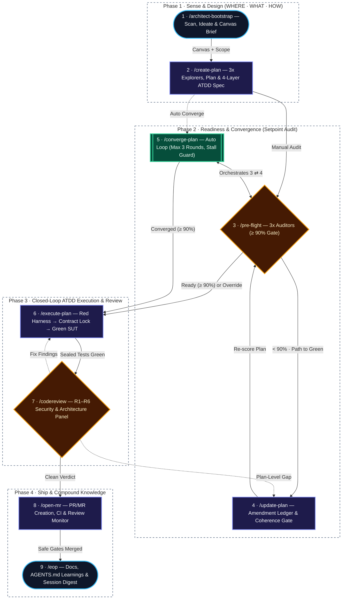

# Agent Pipeline

A complete, multi-harness plugin for **Antigravity (`agy`)**, **Cursor**, **Claude Code**, and **Codex** that turns a vague idea into reviewed, shipped, and documented code through nine structured stages.



## What's in this plugin

One repository root packaged as a multi-harness plugin bundle (`agent-pipeline`):

```
agent-pipeline/
├── plugin.json                            # Antigravity root plugin manifest
├── .cursor-plugin/
│   ├── plugin.json                        # Cursor plugin manifest
│   └── marketplace.json                   # Cursor marketplace catalog entry
├── .claude-plugin/
│   ├── plugin.json                        # Claude Code plugin manifest
│   └── marketplace.json                   # Claude Code marketplace catalog entry
├── .codex-plugin/
│   └── plugin.json                        # Codex plugin manifest
├── .cursor/
│   └── hooks.json                         # Cursor lifecycle hooks (stop + afterFileEdit)
├── assets/
│   └── logo.svg                           # Plugin icon
├── skills/                                # 15 modular skills (progressive disclosure)
│   ├── agent-pipeline/SKILL.md            # Canonical 9-stage pipeline orchestrator
│   ├── architect-bootstrap/SKILL.md       # Stage 1: workspace scan + canvas brief
│   ├── create-plan/SKILL.md               # Stage 2: evidence-backed plan + 4-layer ATDD spec
│   ├── pre-flight/SKILL.md                # Stage 3: confidence audit (iterative, ≥90% gate)
│   ├── update-plan/SKILL.md               # Stage 4: surgical plan amendment + Coherence Gate
│   ├── converge-plan/SKILL.md             # Stage 5: automated pre-flight ⇄ update-plan loop
│   ├── execute-plan/SKILL.md              # Stage 6: Red-First ATDD implementation
│   ├── codereview/SKILL.md                # Stage 7: multi-reviewer panel
│   ├── open-mr/SKILL.md                   # Stage 8: PR/MR creation + CI & review monitor
│   ├── eop/SKILL.md                       # Stage 9: session digest + AGENTS.md learnings
│   ├── uiux-expert/SKILL.md               # Standalone: UI/UX design orchestrator
│   ├── generate-shebangs/SKILL.md         # Standalone: @ai-rules header generator
│   ├── probe-before-assume/SKILL.md       # Foundational: evidence-first behavior
│   ├── cynefin-sense-making/SKILL.md      # Foundational: Cynefin domain classification
│   └── platform-design-review/SKILL.md    # Foundational: platform review (6 tests + 7 C's)
├── agents/                                # 69 worker & specialist subagent definitions
│   ├── codereview.md                      # Core: Principal code reviewer (R1)
│   ├── pre-flight.md                      # Core: Cynefin confidence auditor
│   ├── execute-plan.md                    # Core: Plan executor (production code)
│   ├── execute-plan-tests.md              # Core: Test Specifier (Red-First ATDD)
│   ├── probe-runner.md                    # Core: Safe-to-fail experiment runner
│   ├── uiux-expert.md                     # Core: UI/UX design orchestrator
│   ├── generate-shebangs.md               # Core: @ai-rules header generator
│   ├── ce-*.md                            # 51 Compound Engineering specialists & scouts
│   ├── *-review.md / ci-watcher.md / ...  # 9 compatibility, CI, learning, & code-review agents
│   └── explore.md / general-purpose.md    # 2 pipeline built-in aliases
├── rules/                                 # 14 rules (AGENTS.md + 13 modular rules)
│   ├── AGENTS.md                          # Pipeline contract & cross-session learnings
│   ├── persona.md                         # Systems Architect persona
│   ├── orchestrator-mandate.md            # Main-agent delegation of code mutations
│   ├── cynefin.md                         # Cynefin sense-making framework
│   ├── kiss.md                            # KISS problem-solving principle
│   ├── ai-shebang.md                      # @ai-rules header enforcement
│   ├── ai-rules.md                        # Prompt engineering standards
│   ├── codebase-workflow.md               # Code conventions + context gathering
│   ├── refactor.md                        # Pre-refactor documentation
│   ├── microservices.md                   # Distributed systems patterns
│   ├── platform-strategy.md               # Platform design principles (7 C's)
│   ├── platform-economics.md              # Double Pyramid economics model
│   ├── platform-abstraction-quality.md    # Abstraction vs illusion discipline
│   └── plan-probes.md                     # Complex step probe templates
├── hooks/
│   └── codereview-reminder.sh             # Remind to run /codereview when files changed
├── references/
│   └── architect-brief-canvas.md          # Canvas structure for /architect-bootstrap
├── docs/
│   └── pipeline-howto.md                  # Team onboarding & usage guide
└── LICENSE                                # MIT License
```

## Installation

### Antigravity (`agy`)

Install directly from GitHub:

```bash
agy plugin install https://github.com/tal-hason/agent-pipeline
```

Validate or manage locally:

```bash
agy plugin list
agy plugin validate https://github.com/tal-hason/agent-pipeline --strict
```

### Cursor

Add `https://github.com/tal-hason/agent-pipeline` in **Cursor Settings → Plugins / Marketplaces**, or clone directly into your local Cursor plugins folder:

```bash
git clone https://github.com/tal-hason/agent-pipeline.git ~/.cursor/plugins/local/agent-pipeline
```

### Claude Code

Register the marketplace and install the plugin:

```text
/plugin marketplace add tal-hason/agent-pipeline
/plugin install agent-pipeline@agent-pipeline
```

### Codex / Manual Project-Level

Clone the repository and copy `skills/`, `agents/`, and `rules/` into a project's `.agents/` or `.cursor/` directory:

```bash
git clone https://github.com/tal-hason/agent-pipeline.git
mkdir -p /path/to/project/.agents
cp -r agent-pipeline/{skills,agents,rules} /path/to/project/.agents/
```

## How the pipeline works

See [`docs/pipeline-howto.md`](docs/pipeline-howto.md) for the full guide.

### Quick start

```
/architect-bootstrap ~/Git/my-project

Add a health check endpoint that returns pod readiness and database connectivity
```

The agent scans the workspace, builds a canvas with situational awareness, then guides you through the pipeline:

```
/create-plan        # Build atomic implementation plan + 4-layer ATDD test spec
/pre-flight         # Audit plan confidence (soft gate ≥ 90%)
/update-plan        # Bake Path to Green into the plan (or /converge-plan to auto-loop)
/execute-plan       # Implement via Red-First ATDD closed loop
/codereview         # Multi-reviewer panel
/open-mr            # Push branch, open PR/MR, monitor CI & reviews, merge when safe
/eop                # Capture learnings into AGENTS.md, write session digest
```

### Recommended: Two-session workflow

1. **Session 1 (explore):** Run `/architect-bootstrap` to scan and understand the workspace. Brainstorm with the agent. Ask it to write a focused feature prompt.
2. **Session 2 (execute):** Open a fresh chat. Paste the feature prompt into `/architect-bootstrap`. Run the full pipeline with clean context.

Artifacts on disk bridge the gap — Session 1's canvas, `docs/brainstorms/` requirements, `.agents/plans/` artifacts, and `AGENTS.md` are read automatically by Session 2's `/architect-bootstrap`.

## Design principles

This pipeline is built on:

- **[Cynefin framework](https://en.wikipedia.org/wiki/Cynefin_framework)** — classify problems before solving them (Clear/Complicated/Complex/Chaotic)
- **[Control theory](https://en.wikipedia.org/wiki/Control_theory)** — user intent = setpoint, code = controller, tests/logs = feedback loop
- **[Hexagonal architecture](https://alistair.cockburn.us/hexagonal-architecture/)** — ports & adapters, domain independence
- **[Continuous delivery](https://continuousdelivery.com/)** — small verifiable batches, build quality in
- **[Platform Strategy](https://architectelevator.com/book/platformstrategy/)** (Gregor Hohpe) — 7 C's, Double Pyramid, abstractions not illusions
- **Probe-before-assume** — never act on assumptions when evidence is available
- **Red-First ATDD** — independent test specifier writes failing 4-layer acceptance tests first, locks the test contract, and a separate code executor turns Red into Green
- **Orchestrator mandate** — main agent coordinates and verifies; worker subagents execute all code mutations

## License

[MIT](LICENSE)
