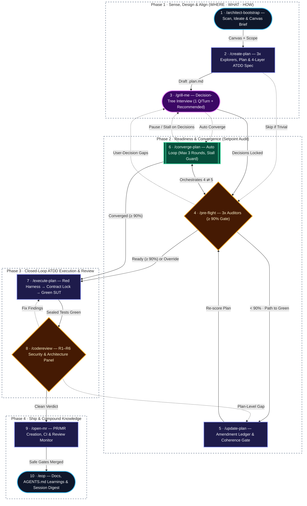

# Agent Pipeline Contract

Shared flow for all pipeline skills. Every stage uses the same pattern:

1. **Main agent** acts purely as an orchestrator and owns the deliverable in the parent chat. **It never executes code mutations directly** — see `rules/orchestrator-mandate.md`.
2. **Context Package by Reference** — pass exact artifact paths, revision hashes, target files, and concise setpoints. Workers use native file/git tools to read source lines. Never duplicate multi-thousand-line diffs or whole files across parallel worker prompts.
3. **Worker subagents** — parallel where useful; `readonly` unless executing code or tests. **All code mutations MUST be delegated to worker subagents.**
4. **Thinking-tier models** for audit/review workers (no `*-fast` models), using a distinct model/provider from the coordinator when supported.
5. **Artifact & File Continuity** — read `AGENTS.md` and prior stage artifacts on disk at the start of every stage; write structured artifacts on disk at the end so subsequent stages and sessions inherit verified state.
6. **Telegraphic Worker Communication** — subagents communicate machine-to-machine (caveman style): zero conversational filler, pleasantries, or narrative preambles. Output findings directly using structured markdown/YAML tables.

## Context & Artifact Continuity

Every pipeline skill starts by reading `AGENTS.md` (workspace and user-level if present) plus relevant prior stage artifacts in `.agents/plans/` (or `.cursor/plans/`), and ends by persisting its deliverable on disk.

| # | Skill | Context read at start | Primary deliverable written |
| :--- | :--- | :--- | :--- |
| 1 | `architect-bootstrap` | `AGENTS.md`, `README`, manifests, existing `docs/brainstorms/` | `architect-brief.canvas.tsx` + chat brief |
| 2 | `create-plan` | `AGENTS.md`, bootstrap canvas brief, `docs/brainstorms/` | `.agents/plans/{slug}.plan.md` |
| 3 | `grill-me` | `AGENTS.md`, `{slug}.plan.md`, latest pre-flight / converge outcome (if any) | Locked Decisions Ledger + updated `{slug}.plan.md` |
| 4 | `pre-flight` | `AGENTS.md`, `{slug}.plan.md`, prior `*-Pre-Flight-Review_*.md` | `{slug}-Pre-Flight-Review_*.md` |
| 5 | `update-plan` | `AGENTS.md`, `{slug}.plan.md`, latest `*-Pre-Flight-Review_*.md` | Updated `{slug}.plan.md` + Amendment Ledger |
| 6 | `converge-plan` | `AGENTS.md`, `{slug}.plan.md`, prior `*-Pre-Flight-Review_*.md` | `{slug}-converge-outcome_*.md` (nested stages write their own artifacts) |
| 7 | `execute-plan` | `AGENTS.md`, `{slug}.plan.md`, latest `*-Pre-Flight-Review_*.md` | Updated todos + sealed tests + code changes + `{slug}-execution-outcome_*.md` |
| 8 | `codereview` | `AGENTS.md`, `{slug}.plan.md`, execution outcome, git diff | `{slug}-Code_Review_*.md` |
| 9 | `open-mr` | `AGENTS.md`, `{slug}.plan.md`, latest `*-Code_Review_*.md` | PR/MR URL + `{slug-or-branch}-open-mr-outcome_*.md` |
| 10 | `eop` | `AGENTS.md`, all session artifacts produced in stages 1–9 | `.agents/digests/{slug}-session-digest_*.md` + `AGENTS.md` delta |

## Flow



## Stage summary

| # | Skill | Actor | Workers | Primary deliverable | Reference |
| :--- | :--- | :--- | :--- | :--- | :--- |
| 1 | `architect-bootstrap` | main agent | **WHAT:** ideation (main agent, Step 2.5 when vague). **WHERE:** scanners A–C + conditional D–J | Canvas + situational brief (+ optional `docs/brainstorms/` requirements) | [architect-bootstrap](../architect-bootstrap/SKILL.md) |
| 2 | `create-plan` | main agent | 3× evidence explorers (`ce-repo-research-analyst`, `explore`, `ce-correctness-reviewer`) | `{slug}.plan.md` | [create-plan](../create-plan/SKILL.md) |
| 3 | `grill-me` | main agent | None (interactive decision-tree interview; probes codebase directly) | Locked Decisions Ledger + updated `{slug}.plan.md` | [grill-me](../grill-me/SKILL.md) |
| 4 | `pre-flight` | main agent | 3× `pre-flight` auditors (+ optional `ce-security-lens-reviewer`) | `{slug}-Pre-Flight-Review_*.md` | [pre-flight](../pre-flight/SKILL.md) |
| 5 | `update-plan` | main agent | Conditional: 0–2 targeted explorers (`explore`, `ce-correctness-reviewer`) for `evidence-gap` only | Updated `{slug}.plan.md` + Amendment Ledger | [update-plan](../update-plan/SKILL.md) |
| 6 | `converge-plan` | main agent | Orchestrates nested `/pre-flight` + `/update-plan` | `{slug}-converge-outcome_*.md` | [converge-plan](../converge-plan/SKILL.md) |
| 7 | `execute-plan` | main agent | Red-First ATDD: 1× `execute-plan-tests` (Red harness) → Contract Lock → 1× `execute-plan` (Green implementation) | Updated plan todos + sealed tests + code changes + reconciliation | [execute-plan](../execute-plan/SKILL.md) |
| 8 | `codereview` | main agent | Core R1–R6 (**R5/R6 security always** except docs-only) + conditional `ce-*` auditors | `{slug}-Code_Review_*.md` | [codereview](../codereview/SKILL.md) |
| 9 | `open-mr` | main agent | None (`gh` / `glab` CLI monitor) | PR/MR URL + `{slug-or-branch}-open-mr-outcome_*.md` | [open-mr](../open-mr/SKILL.md) |
| 10 | `eop` | main agent | None (terminal) | `{slug}-session-digest_*.md` + `AGENTS.md` delta + doc/issue updates | [eop](../eop/SKILL.md) |

## Iteration rules

| Loop | Behavior |
| :--- | :--- |
| **`create-plan → grill-me → pre-flight / converge-plan`** | **Default design alignment.** Stress-test every branch of `.plan.md`'s decision tree interactively before running auditors. Skip only for Clear/trivial plans. |
| **`pre-flight / converge-plan → grill-me`** | **Conditional blocker resolution.** When `/pre-flight`, `/update-plan`, or `/converge-plan` pauses or stalls on `user-decision` trade-offs, run `/grill-me` to lock decisions into `.plan.md`, then re-run `/pre-flight` or `/converge-plan`. |
| **`/converge-plan`** | **Automated path to green.** Runs `/pre-flight` ⇄ `/update-plan` until Ready (≥90%, not Stop), stall, max rounds (default 3), user-decision pause, or redesign abort. **Never** auto-executes. |
| **pre-flight → update-plan → pre-flight** | Manual path to green (same mechanics, user re-invokes). |
| **pre-flight → pre-flight** | Allowed if the user already edited the plan manually. Prefer `/update-plan` or `/converge-plan`. |
| **update-plan → update-plan** | Allowed when user supplies decisions for `user-decision` rows. |
| **execute-plan → update-plan / converge-plan** | Allowed if execution reveals plan gaps (not a failure). |
| **codereview → update-plan / converge-plan** | Allowed if review finds plan-level issues. |
| **update-plan / converge → create-plan** | When blast radius is a redesign — stop and recommend `/create-plan`. |

## Execute gate (soft)

`/execute-plan` reads the **latest** `*-Pre-Flight-Review_*.md` for the plan slug:

- **≥ 90%** and not Stop → proceed
- **< 90%** or Stop → show blockers; suggest **`/converge-plan`** or **`/update-plan`** then `/pre-flight` (or **`/grill-me`** if blocked on `user-decision` trade-offs), or **explicitly override** to execute anyway
- **No report** → recommend `/pre-flight` or `/converge-plan` first; user may override

## Worker subagents (by stage)

Main agent owns each deliverable. Dispatch **workers only** with the Context Package by Reference for that stage.

| Stage | Skill | Worker `subagent_type` (examples) | Reference docs |
| :--- | :--- | :--- | :--- |
| 1 | `architect-bootstrap` | `ce-repo-research-analyst`, `explore`, `ce-architecture-strategist`, compat lane (`D–G`), `ce-git-history-analyzer`, … | `../../references/architect-brief-canvas.md` |
| 2 | `create-plan` | `ce-repo-research-analyst`, `explore`, `ce-correctness-reviewer` | [create-plan](../create-plan/SKILL.md) |
| 3 | `grill-me` | None (interactive main-agent interview) | [grill-me](../grill-me/SKILL.md) |
| 4 | `pre-flight` | `pre-flight` (×3), optional `ce-security-lens-reviewer` | `../../agents/pre-flight.md` |
| 5 | `update-plan` | Conditional `explore` / `ce-correctness-reviewer` (evidence-gap only) | [update-plan](../update-plan/SKILL.md) |
| 6 | `converge-plan` | Nested workers from stages 4–5 | [converge-plan](../converge-plan/SKILL.md) |
| 7 | `execute-plan` | `execute-plan-tests` (Red harness) → `execute-plan` (Green SUT), `probe-runner` (Complex steps) | `../../agents/execute-plan.md`, `../../agents/execute-plan-tests.md` |
| 8 | `codereview` | `codereview`, `ce-*` panel, `code-reviewer` | `../../agents/codereview.md` |
| 9 | `open-mr` | None (`gh` / `glab` CLI monitor) | [open-mr](../open-mr/SKILL.md) |

Both bootstrap ideation (Step 2.5) and `/grill-me` (Stage 3 / conditional blocker loop) run interactively in the **main agent** — never as background Task workers.

## Git workflow

After `/execute-plan` + `/codereview`, ship via **`/open-mr`** (preferred) or manual push/PR:

```
work complete → branch out → /codereview → /open-mr (push + PR/MR + monitor + merge when safe) → /eop
```

| Step | When | Action |
| :--- | :--- | :--- |
| Branch out | After `/execute-plan` (code changes on disk) | Create a feature branch from the working state |
| `/codereview` | On the branch | Review panel; fix findings before ship |
| `/open-mr` | After review is clean (or user override) | Push, create PR/MR, monitor CI & reviews, merge when green/safe |
| Manual fallback | If `/open-mr` not used | `git push -u origin HEAD` + `gh pr create` / `glab mr create` |
| `/eop` | After merge (or when closing session) | Digest + `AGENTS.md` learnings + doc/issue updates |

**Rules:**
- Never push directly to `main`/`master` — always branch + PR/MR.
- Prefer `/open-mr` so CI and review triage sequencing is enforced.
- Do not enable auto-merge on repos where automated CI bots push commits directly to PR/MR branches.

## Skill handoffs (end each stage with)

| After skill | CTA |
| :--- | :--- |
| `architect-bootstrap` | *"Bootstrap complete. Run `/create-plan` when ready."* |
| `create-plan` | *"Plan written. Run `/grill-me` to stress-test design decisions (recommended), or `/pre-flight` / `/converge-plan` if decisions are already locked."* |
| `grill-me` | *"Decisions locked into `{slug}.plan.md`. Run `/pre-flight` or `/converge-plan`."* |
| `pre-flight` | *"Confidence {N}%. Run #{K}. {Ready → `/execute-plan` \| user-decision gaps → `/grill-me` \| else → `/update-plan` / `/converge-plan`}."* |
| `update-plan` | *"Plan updated. Run `/pre-flight` or `/converge-plan` to re-score."* (Or `/grill-me` if blocked on user decisions.) |
| `converge-plan` | Per terminal reason — Ready → `/execute-plan`; Pause/Stall on decisions → `/grill-me`; else max / `/create-plan` |
| `execute-plan` | *"Branch out and run `/codereview`"* (or `/update-plan` / `/converge-plan` if plan gaps) |
| `codereview` | If clean: *"Run `/open-mr` to push, open the PR/MR, and monitor to merge."* Else fix findings or `/update-plan` / `/converge-plan`. |
| `open-mr` | Merged → *"Run `/eop`."* Paused/blocked → user action then re-invoke `/open-mr` on the same URL. |
| `eop` | *"Pipeline complete. Session learnings captured. Digest at `{path}`."* (terminal) |
